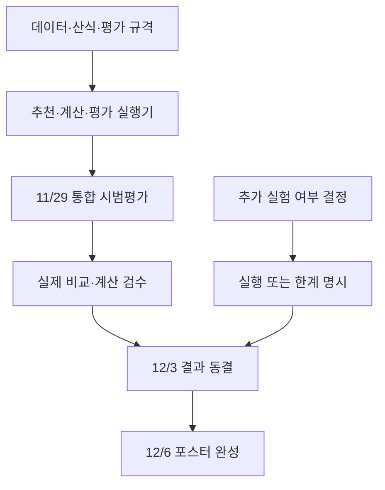

# 일정과 완료 기준

- 기준일은 2026-11-24임. 기존 일정의 근거는 [schedule.txt](https://drive.google.com/file/d/1huuMd6EX_6p7StmoCFlwfwobfDZNVdOj/view?usp=drivesdk)임.
- 아래에서 ‘기존 확정’ 이외의 날짜는 이번에 제안한 세부 마감임. 회의 시간·발표 시간·장소는 원문에 없음.

| 기간/마감 | 남겨야 할 결과 | 담당 | 일정 근거 |
|---|---|---|---|
| 11/24–25 | 기준 원본·현재 앱 코드·범위 공유 | 선우·재영 | 제안 |
| 11/26 | 데이터 규격·Gold 초안 검수·에너지 산식/계수 | 선우·건희·수현 | 제안 |
| 11/27 | 평가 조건·공정 입력값/가정 동결 | 건희·수현 | 제안 |
| 11/28 | 범위·역할·재실험 여부 결정; 평가 실행기 준비 | 전원·팀장님 | 회의일 기존 확정 |
| 11/29 | 추천+에너지 통합 및 시범평가 결과 검토 | 전원·팀장님 | 회의일 기존 확정 |
| 11/30–12/2 | 오류 수정·최종 비교·에너지 대조; 가능한 경우 DSPy 검증 | 재영·건희·수현 | 제안 |
| 12/3 | 포스터에 넣을 표·그림·주장 동결 | 선우·전원 | 제안 |
| 12/4 | 포스터 첫 완성본 | 선우, 파트 담당 전원 | 제안 |
| 12/5 | 파트별 교차검수 | 전원 | 제안 |
| 12/6 | 포스터 최종본 | 선우·전원 | 기존 확정 |
| 12/7–18 | 연구 업무 배정 없음 | 전원 | 기존 시험기간 |
| 12/19–23 | 시연 복구 점검·리허설·질의응답 | 전원 | 제안 |
| 12/24–28 | 출력·접속·영상 백업 점검 | 전원 | 제안 |
| 12/29 | 최종 성과발표 | 전원 | 기존 확정 |

## 서로 기다려야 하는 작업

## 지연 시 적용할 기준

- 공정 입력이 부족하면 문헌 가정의 시나리오 계산으로 범위를 줄이며 실측 절감량으로 표현하지 않음.
- 독립된 인간 채점 보정자료가 없으면 DSPy 최적화를 미완료로 남기고, 고정 수동 루브릭과 인간 채점을 우선함.
- 추가 실험은 11/28에 가능 여부를 결정함. 시료·장비·독립 반복이 확보되지 않으면 기존 분석의 한계를 명시하고 일정에서 분리함.
- 12/3 이후 결과를 추가할 때에는 포스터·점수표·앱 버전의 동시 검수가 필요함. 시험기간에 연구 일정을 넘기지 않음.
- 상호작용 지도 확대·Local LLM 이전·임베딩 검색 교체·추론 전력 추정은 필수 결과를 지연시키지 않는 조건에서만 검토함.
